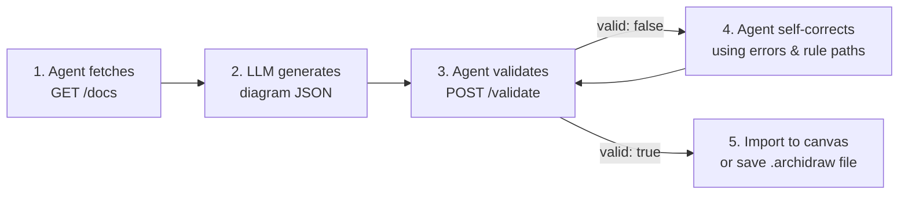

<div align="center">


# ArchiDraw

**Hand-drawn style architecture diagram editor that runs entirely in your browser.**

[](https://github.com/alissonpdc/archidraw/actions)
[](https://nodejs.org/)
[](https://www.typescriptlang.org)
[](LICENSE)

</div>

ArchiDraw is a client-side canvas app for drawing [software architecture diagrams](https://en.wikipedia.org/wiki/Architecture_diagram) with a hand-sketched look. It ships with built-in AWS and Kubernetes component libraries, smart arrow binding, and multi-tab workspaces — with no backend, sign-up, or data leaving your machine.


## Features

### Drawing & rendering
- **Sketch-style rendering** — clean to hand-drawn shapes via *roughness* (4 discrete levels), with hachure/cross-hachure fills and solid/dashed/dotted/dash-dot strokes.
- **Deterministic rough paths** — per-element seed ensures identical rendering on screen, SVG export, and re-open.
- **Rich text & labels** — in-place editing with fonts, bold/italic/underline, alignment, per-element text color, vertical alignment, and fine-grained text offsets.

### Architecture-first tools
- **Built-in AWS & Kubernetes library** — ~50+ icons organized by Compute, Network, Database, Storage, Messaging, Security, and Monitoring. No community library needed.
- **Context containers** — native `ContextElement` for DDD modeling with label positioning, internal/external sides, and child containment.
- **Smart edges** — auto-routing (`lineType: "auto"`), Bezier control points, bend points, segment dragging, parametric label positioning (`labelT`), and optional flowing-dash animation.
- **Details badge** — hidden technical metadata (payload, latency, notes) on any element, visible on demand.
- **Dependency highlighting** — BFS traversal from selection to illuminate connected elements.

### Workspace & productivity
- **Multi-tab workspaces** — several diagrams per session with per-tab undo/redo, renaming, and reordering.
- **Alignment & distribution** — align and distribute multi-selections horizontally or vertically.
- **Copy/paste style** — copy visual properties between elements.
- **Paste at cursor** — clipboard content lands exactly where you point.
- **Element locking** — lock elements to prevent accidental moves or edits.
- **Focus mode** — hide all UI chrome for distraction-free drawing.

### Theming & appearance
- **4 skins** — Midnight, Blueprint, Warm, and Ink.
- **Light / dark / system** theme with automatic background switching.
- **Dot or line grid** with master lines every 5 units.
- **Custom canvas backgrounds** per skin.

### No cloud, no lock-in
- Autosaved to `localStorage`. Import/export as JSON. No account, no server, no data leaving your machine.

### AI & automation
- **Machine-oriented syntax reference (`/docs`)** — raw Markdown documentation served directly without SPA overhead, tailored for AI agents and LLM prompts.
- **Validation endpoint (`POST /validate`)** — instant, headless validation of generated diagrams and elements with JSON-pointer error reporting.

## Excalidraw Compatible

ArchiDraw reads [Excalidraw](https://excalidraw.com/) files natively — open your existing diagrams and libraries without conversion.

| Format | Direction | What's preserved |
|---|---|---|
| `.excalidraw` | Import | Shapes, colors, roughness, arrow bindings, fonts, opacity, arrowheads, text |
| `.excalidrawlib` | Import (v1 + v2) | Library items → registered as reusable catalog components |
| `.archidrawlib` | Export | Custom library in Excalidraw v2-compatible format |

> [!NOTE]
> Compatibility is **one-way**: ArchiDraw imports Excalidraw files, but Excalidraw cannot open `.archidraw` or `.archidrawlib` files.

## ArchiDraw vs Excalidraw

ArchiDraw is not a general-purpose whiteboard — it's a **dedicated architecture diagram editor**. Here's what sets it apart.

### What ArchiDraw has that Excalidraw doesn't

| Feature | ArchiDraw | Excalidraw |
|---|---|---|
| Built-in AWS / Kubernetes icons | ✅ ~50+ native | ❌ community libraries only |
| Auto-routed edges | ✅ orthogonal with bend points | ❌ |
| Bezier control points | ✅ | ❌ |
| Animated arrows (data flow) | ✅ | ❌ |
| Dash-dot stroke style | ✅ | ❌ |
| Parametric label on edges (`labelT`) | ✅ | ❌ |
| Context containers (DDD semantics) | ✅ | Frames only (generic) |
| Details / hidden metadata per element | ✅ | ❌ |
| Split fill / stroke opacity | ✅ | ❌ |
| Vertical text alignment + text offsets | ✅ | ❌ |
| Multi-tab workspace | ✅ | ❌ |
| 4 skins (Midnight, Blueprint, Warm, Ink) | ✅ | ❌ |
| Dependency highlighting (BFS) | ✅ | ❌ |
| Alignment & distribution tools | ✅ | ❌ |
| Copy/paste style | ✅ | ❌ |
| Element locking | ✅ | ❌ |
| Deterministic rough-path export | ✅ | ❌ |
| Paste at cursor position | ✅ | ❌ |
| Dot **and** line grid | ✅ | grid only |

## Getting started

### With Docker (recommended)

```bash
docker run -d --name archidraw -p 5000:5000 alissonpdc/archidraw:latest
```

Open `http://localhost:5000` and start drawing.

### From source

Requirements: **Node.js 22+** and npm.

```bash
git clone https://github.com/alissonpdc/archidraw.git && cd archidraw
make install
make run
```

Open `http://localhost:5173` and start drawing.

## Usage

The toolbar holds the drawing tools: selection, hand, rectangle, diamond, ellipse, line, arrow, and text. Open the component library with `L`; drag or click an item to place it on the canvas.

| Shortcut | Action |
|---|---|
| `1`–`7` | Select drawing tool (selection, hand, rect, diamond, ellipse, line, arrow, text) |
| `Shift` | 45° angle snapping / perfect shapes while drawing |
| `Space` / middle-click | Pan |
| `⌘/Ctrl + scroll` | Zoom |
| `Shift + 1` | Zoom to fit |
| `⌘/Ctrl + G`/`⇧G` | Group / ungroup |
| `⌘/Ctrl + D` | Duplicate |
| `⌘/Ctrl + Z` / `⇧Z` or `Y` | Undo / redo |
| `⌘/Ctrl + O` / `S` | Open / save file |
| `?` | Shortcut reference |

Double-click an element to edit its label or text; double-click empty canvas to create free text.

## File formats

| Format | Direction | Description |
|---|---|---|
| `.archidraw` | Save / Open | ArchiDraw workspace (multi-tab, schema v2) or single diagram |
| `.excalidraw` | Import | [Excalidraw](https://excalidraw.com/) scene — shapes, bindings, fonts, roughness, opacity, arrowheads |
| `.excalidrawlib` | Import | Excalidraw library (v1 & v2) → items become reusable catalog components |
| `.archidrawlib` | Export | Custom library in Excalidraw v2-compatible format |
| `PNG` / `SVG` | Export | Active diagram as raster or vector (deterministic rough paths preserved) |
| `image/*` | Insert | Paste/drop raster images → embedded as library assets |

## AI Agent Integration

ArchiDraw is designed from the ground up to support programmatic diagram authoring and AI agent workflows (LLMs, autonomous coding assistants, and CI/CD pipelines). Any running instance (Docker or local Node server) provides dedicated, lightweight HTTP endpoints to inspect syntax specifications and validate diagram payloads without requiring a headless browser or SPA rendering.

### Typical Agent Workflow



---

### 1. Machine-Readable Syntax Reference (`GET /docs` and `GET /docs.md`)

Agents can read the full ArchiDraw document model, schema definitions, and coordinate rules by fetching `/docs` (or `/docs.md`):

```bash
curl -s http://localhost:5000/docs
```

- **Zero SPA overhead**: Serves `text/markdown; charset=utf-8` directly from the server — no JavaScript execution, React hydration, or HTML scraping needed.
- **Context-injection ready**: Pure Markdown designed to be piped directly into LLM system prompts or retrieved via tool-use loops.
- **Comprehensive specification**:
  - **The 3 interchange formats**: Workspace files (`.archidraw` multi-tab, schema v2), clipboard envelopes (`{ schemaVersion: 1, type: "archidraw/elements", elements: [...] }`), and component libraries (`.archidrawlib` / `.excalidrawlib`).
  - **Element model**: Coordinates (`x`, `y`), dimensions (`width`, `height`), `angle`, stroke styles, fill styles, `roughness` (0 to 3), `borderRadius`, edge bindings (`startBinding`, `endBinding`), auto-routing, and text alignment.
  - **Built-in icon catalog**: Exact `componentId` values for ~50+ AWS and Kubernetes architecture components (e.g., `lambda`, `ec2`, `rds`, `s3`, `k8s-pod`, `k8s-ingress`).
- **Guaranteed valid**: Every JSON example and code snippet in `/docs` is executed and tested against the real application parsers during CI.

---

### 2. Diagram Validation API (`POST /validate`)

Before writing a diagram to disk, serving it to a user, or pasting elements onto the canvas, agents can verify the payload using `POST /validate`:

```bash
curl -X POST http://localhost:5000/validate \
  -H "Content-Type: application/json" \
  --data-binary @diagram.archidraw
```

#### Key Capabilities
- **Universal availability**: Built into Vite development/preview middleware and the production Node server / Docker container.
- **Automatic format detection**: Automatically identifies whether the payload is:
  - `workspace` (schema v2 with `tabs`)
  - `workspace-legacy` (schema v1 single diagram)
  - `library` (`.archidrawlib` / `.excalidrawlib`)
  - `clipboard` (envelope or bare array of elements)
  - `element` (single element object)
- **Status codes**:
  - `200`: Payload was successfully parsed and evaluated. The verification verdict (`valid: true | false`) is inside the response body.
  - `400`: Malformed JSON or unreadable request body.
  - `405`: Method not allowed (only `POST` and `OPTIONS` are supported; `GET` returns usage instructions).
  - `413`: Payload exceeds maximum body size (8 MB).

#### Structured Agent Diagnostics

The JSON response cleanly separates breaking errors from non-fatal warnings:

```json
{
  "valid": false,
  "format": "workspace",
  "errors": [
    {
      "path": "tabs[0].doc.elements[2].type",
      "message": "type inválido: \"hexagon\" — esperado um de [rectangle, diamond, ellipse, line, arrow, text, component, context]",
      "rule": "3.4"
    }
  ],
  "warnings": [
    {
      "path": "tabs[0].doc.elements[2].strokeColor",
      "message": "campo base ausente strokeColor — em .archidraw escreva explicitamente; no paste vira default",
      "rule": "3.2"
    }
  ],
  "summary": {
    "tabs": 1,
    "elements": 3
  }
}
```

| Field | Description | Agent Action |
|---|---|---|
| `valid` | `true` only if the real parser would accept the payload without rejecting it | If `false`, do not import; inspect `errors` to fix. |
| `format` | Detected payload format (`workspace`, `library`, `clipboard`, `element`, `unknown`) | Verify that the detected format matches your intended target. |
| `errors` | Array of breaking issues (`path`, `message`, `rule`) | Map `path` directly to the JSON node and reference `rule` (the corresponding section in `/docs`) to fix. |
| `warnings` | Array of tolerated issues (defaulted or dropped fields) | Informational. For example, rule `5.1` warns if a library item lacks `archidrawElements` editable vectors. |
| `summary` | Statistics on elements, tabs, and library items | Sanity check on the generated output structure. |

---

### Tips for AI Prompting & Code Generation

1. **Provide `/docs` as context**: In your agent prompt, fetch or embed `http://localhost:5000/docs` to give the model exact syntax rules, default styles, and geometry formulas.
2. **Implement an automated fix loop**:
   ```python
   # Pseudocode for an autonomous agent generation loop
   spec = fetch("http://localhost:5000/docs")
   payload = llm.generate_diagram(user_prompt, syntax_reference=spec)

   for attempt in range(3):
       result = http_post("http://localhost:5000/validate", json=payload)
       if result["valid"]:
           break
       payload = llm.fix_json(payload, errors=result["errors"])
   ```
3. **Use the official catalog**: Prefer native components (e.g., `{ "type": "component", "componentId": "lambda" }`) over generic drawn boxes when representing standard cloud and Kubernetes resources.

## License

[Apache-2.0](LICENSE)