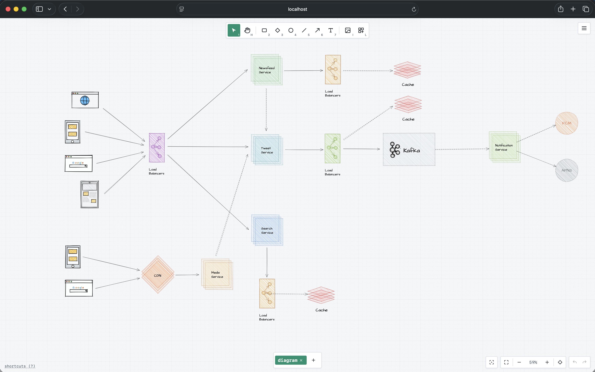

<div align="center">


# ArchiDraw

**Hand-drawn software architecture diagrams right in your browser.**

[](https://github.com/alissonpdc/archidraw/actions)
[](https://nodejs.org/)
[](https://www.typescriptlang.org)
[](LICENSE)

</div>

ArchiDraw is a fast, client-side canvas editor designed specifically for software architecture diagrams with an organic, hand-sketched aesthetic. It comes preloaded with AWS and Kubernetes icons, smart auto-routing connectors, DDD context boundaries, and multi-tab workspaces — with **no login, no backend, and zero data leaving your browser**.



---

## ⚡ Quick Start

### Run with Docker (Recommended)

Get up and running with a single command:

```bash
docker run -d --name archidraw -p 5000:5000 alissonpdc/archidraw:latest
```

Open **`http://localhost:5000`** in your browser and start drawing.

### Run from Source

Requires **Node.js 22+**:

```bash
git clone https://github.com/alissonpdc/archidraw.git && cd archidraw
make install
make run
```

Then visit **`http://localhost:5173`**.

---

## ✨ Why ArchiDraw?

- ☁️ **Built-in Cloud & Architecture Libraries**  
  Over 50+ native AWS and Kubernetes components (Compute, Storage, Database, Networking, K8s Pods, Ingress, etc.) built right into the app — no need to search, download, or configure external icon packs.

- 🔀 **Smart Connectors & Flow Lines**  
  Arrows auto-route orthogonally around shapes, snap to connection points, and support Bezier curves, adjustable bend points, labels, and animated flowing dashes to represent live data streams.

- 🏛️ **Domain-Driven Architecture Tools**  
  Native Context containers for DDD system modeling, technical details badges (payloads, latency, notes) on any element, and BFS dependency highlighting to trace connections across your architecture.

- 🎨 **Sketch Aesthetics & Custom Skins**  
  Hand-drawn roughness controls, hachure/cross-hachure fills, and multiple visual skins (**Midnight**, **Blueprint**, **Warm**, and **Ink**) with dark/light mode and configurable dot/line grids.

- 📑 **Multi-Tab Workspaces**  
  Work on multiple diagrams simultaneously within a single session, each with independent undo/redo history, tab renaming, and reordering.

- 🔒 **100% Private & Local-First**  
  Your diagrams are autosaved directly to your browser's local storage. No accounts, no telemetry, no tracking, and no cloud dependencies.

- 🔄 **Excalidraw Compatible**  
  Import existing `.excalidraw` scenes and `.excalidrawlib` component libraries seamlessly.

---

## 🆚 ArchiDraw vs Excalidraw

While Excalidraw is a great general-purpose whiteboard, ArchiDraw is purposefully built for **system architecture and engineering teams**:

| Capability | ArchiDraw | Excalidraw |
|---|---|---|
| **Native Cloud Icons** | ✅ Built-in AWS & Kubernetes catalog | ❌ External community libraries only |
| **Edge Routing** | ✅ Orthogonal auto-routing with bend points | ❌ Manual curves only |
| **Data Flow Animation** | ✅ Flowing animated arrows | ❌ Static arrows only |
| **Architecture Contexts** | ✅ Native DDD Context containers | ❌ Generic frames |
| **Technical Metadata** | ✅ Details badge (payloads, latency, notes) | ❌ |
| **Dependency Highlighting** | ✅ Trace connected elements via BFS | ❌ |
| **Multi-Tab Workspace** | ✅ Multiple diagrams per session | ❌ Single canvas |
| **Themes & Skins** | ✅ 4 Skins (Midnight, Blueprint, Warm, Ink) | ❌ Single default style |
| **Precise Typography** | ✅ Vertical alignment & fine offsets | ❌ Basic text options |
| **Grid Customization** | ✅ Dot and line grids with master divisions | ❌ Dot grid only |

---

## ⌨️ Common Shortcuts

| Shortcut | Action |
|---|---|
| `1` – `7` | Tools: Select, Hand, Rectangle, Diamond, Ellipse, Line, Arrow, Text |
| `L` | Toggle Component Library (AWS, Kubernetes) |
| `Space` / Middle-click | Pan canvas |
| `⌘ / Ctrl` + Scroll | Zoom in / out |
| `Shift + 1` | Zoom to fit all elements |
| `⌘ / Ctrl + G` / `⇧ + G` | Group / Ungroup elements |
| `⌘ / Ctrl + D` | Duplicate selection |
| `⌘ / Ctrl + Z` / `⇧ + Z` | Undo / Redo |
| `⌘ / Ctrl + S` / `O` | Save workspace / Open file |
| `?` | Show all keyboard shortcuts |

> **Tip:** Double-click any element to edit its label. Double-click empty canvas to create text anywhere.

---

## 📁 Supported Formats

| Format | Direction | Description |
|---|---|---|
| `.archidraw` | Open / Save | Full multi-tab workspace or single diagram file |
| `.excalidraw` | Import | Excalidraw diagrams (shapes, bindings, text, styles) |
| `.excalidrawlib` | Import | Excalidraw component libraries (v1 & v2) |
| `.archidrawlib` | Export | Custom component library compatible with Excalidraw format |
| `PNG` / `SVG` | Export | High-resolution raster image or vector graphic |
| Images | Insert | Drag-and-drop or paste raster images directly onto the canvas |

---

## 🤖 AI & Automation Ready

ArchiDraw also supports automated diagram generation and LLM workflows. Any running instance exposes lightweight endpoints for programmatic diagram generation:

- **`GET /ai` (and `/ai/<slug>.md`)**: Full and modular machine-readable Markdown specifications of the document model, component catalog, and coordinate system.
- **`POST /validate`**: Headless JSON validation API to check generated diagrams with descriptive errors and warnings before rendering.

For complete schema details and prompt integration examples, see the [Syntax & API Documentation](src/ai/index.md).

---

## 📄 License

Licensed under the [Apache-2.0 License](LICENSE).